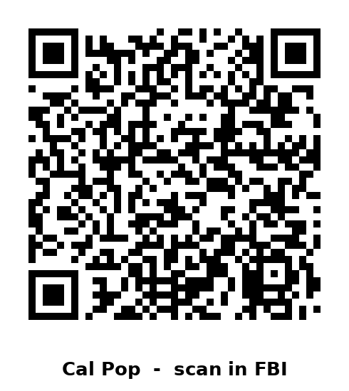

# Cal Pop (3DS)

The colorful edition of Cal Tracker 3DS. It shares its data folder with the plain version, so both apps see the same log.

A standalone calorie and macro tracker for the Nintendo 3DS (homebrew). It keeps its own food log on the SD card and looks foods up on [Open Food Facts](https://world.openfoodfacts.org). It needs no account and no server.

## Features

- Daily view of calories, protein, carbs and fat against your own targets.
- Log foods to Breakfast, Lunch, Dinner or Snacks, with grams.
- Online food search through Open Food Facts.
- Saved foods: everything you log is cached, so re-logging works offline.
- Custom foods entered per serving.
- Browse, edit and delete past days.

## Cal Pop extras

- One color gradient everywhere: green, turquoise, blue.
- Touch tab bar on the bottom screen: Today, Search, Brands, Favs, Meals, Profile (L and R also switch tabs).
- **Favorites:** press X on any food to star it; on the Favs tab, A logs it with its usual grams.
- **Quick add:** type a name with calories and macros, no grams needed.
- **Saved meals:** on Meals, tap *+ New meal* and name it. Then pick foods the same way you log them: A on Search, Favs or Brands adds the food to the meal instead of your day. *Quick item* adds a name with macros. Tap the strip at the bottom to go back and *Save meal*. Log it later from the Meals tab, normal size or scaled.
- **My Brands:** follow brands like Quest or Barebells and browse their products. Small typos are fixed for you (typing "goodless" finds Goodles and renames the tile). Product lists are saved for offline use; Y refreshes.
- **Profile** (Left/Right switch pages):
  - *Profile:* age, sex, weight log, height, BMI, body fat, activity level and your daily targets.
  - *Activity:* today's steps straight from the 3DS step counter (with an hourly chart) and roughly what they burned, as a heads-up, plus your workouts. Pick a workout type (weights, running, soccer...) and the minutes; calories come from your weight. *Other* lets you type the calories yourself.
  - *Report:* eaten vs burned for the day. Burned is resting energy (Mifflin-St Jeor BMR) plus basic activity (from your activity level) plus workouts. Steps are shown next to it but not added, since basic activity already covers normal walking.
  - *Charts:* calories per day for the week, split into protein, carbs and fat, and a weight line.
- Steps are worth about 0.5 kcal per kg per km walked, with your stride worked out from your height. Workouts use MET values from the Compendium of Physical Activities, minus resting energy so nothing is counted twice.
- **Barcode scanner:** tap *Scan* on Today (or *Scan barcode* on Search) and point the outer camera at an EAN-13, UPC-A or EAN-8 barcode. The product is looked up on Open Food Facts and opens in Search, ready to log with A. If a code won't read, press X (or *Type barcode* on Search), pick EAN-13, UPC-A or EAN-8 and type the numbers under the bars; typos are caught by the check digit.
- **Servings and other measures:** pressing A on a food asks *How much?*: servings (using the product's own serving, like "1 bar = 60 g"), grams, ounces, or ml and cups for drinks. Today shows what you typed ("1.5 bars", "2 oz"); Y changes it.
- **Micronutrients:** fiber, sugar, sodium, iron and zinc sit under the macros on Today. *All micros* shows all 14 (also saturated fat, cholesterol, calcium, magnesium, potassium and vitamins A, C, D and B12) against US reference amounts for your age and sex. Sugar, sodium, saturated fat and cholesterol are shown as daily maximums. Many products don't list micronutrients, so real totals are often higher.
- **Water:** *+ Water* and *-* on Today (or ZR / ZL) count glasses of 250 ml. Set the goal in Profile.
- **Streak:** a goal day means calories within 10% of your target and at least 90% of your protein target. The flame on Today counts goal days in a row.
- **Mascot:** a little macaroni lives on Today. It cheers when you reach your protein goal and wears a party hat on a 3+ day streak.
- **Sounds:** soft effects for logging, water, goals, scanning and switching tabs, made in code. Turn them off in Profile. They need the DSP firmware (`sdmc:/3ds/dspfirm.cdc`, made during the usual homebrew setup); without it the app is silent.
- HOME menu banner: one macaroni with an original ocarina-style tune over a harp chord (CIA only; made by `tools/make_assets.py`).
- "Adding to" picker on the bottom screen (or Left/Right) chooses the meal food goes into.

## Controls (plain version)

| Screen | Button | Action |
| --- | --- | --- |
| Day | A | Add food |
| Day | X / Y | Remove entry / change grams |
| Day | Left, Right (or L, R) | Previous / next day |
| Day | B | Jump back to today |
| Day | SELECT | Set daily targets |
| Add food | A | Log the selected saved food |
| Add food | Y | Search online |
| Add food | X | Create a custom food |
| Add food, results | L, R | Change meal |
| Any | START | Quit |

## Install

**Quickest way:** in FBI on your 3DS, go to *Remote Install > Scan QR Code* and scan this. It always installs the newest build, and scanning it again updates the app (your logs and foods stay).



It points to https://github.com/cesarg3204-boop/cal-tracker-3ds/releases/download/cal-pop-latest/cal-pop.cia

Each **Build** run on the Actions tab has two downloads:

- `cal-pop-cia`: a CIA to install with FBI, or to open in an emulator (File > Install CIA).
- `cal-pop`: a `.3dsx` for the Homebrew Launcher; copy it to `sdmc:/3ds/`.

Data lives in `sdmc:/3ds/caltracker/`: `log/YYYY-MM-DD.json` per day, `foods.json` for saved foods, `targets.json` for your targets, plus Cal Pop's `favorites.json`, `meals.json`, `brands.json`, `profile.json`, `weights.json`, `steps.json` and `workouts.json`.

## Build

With [devkitPro](https://devkitpro.org/wiki/Getting_Started) installed:

```sh
dkp-pacman -S 3ds-dev 3ds-curl 3ds-mbedtls 3ds-zlib
make
```

The portable core (log storage, nutrient maths, Open Food Facts parsing) has tests that run on a PC:

```sh
make -f Makefile.tests
```

## Credits

- Food data from [Open Food Facts](https://world.openfoodfacts.org) (ODbL).
- [cJSON](https://github.com/DaveGamble/cJSON) (MIT), vendored in `source/lib`.
- CA bundle in `romfs/cacert.pem` from [certifi](https://github.com/certifi/python-certifi) (MPL 2.0).
